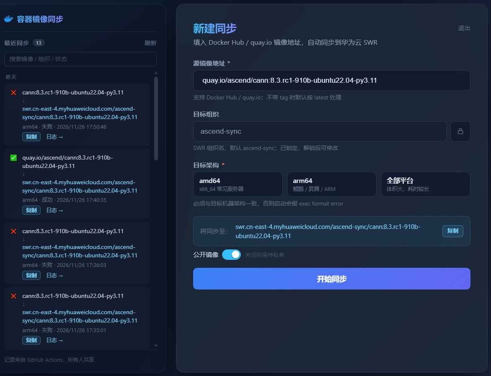

# dockerImageSync

[](https://github.com/Jason0816/dockerImageSync/actions/workflows/sync-images.yml)
[](LICENSE)
[](https://workers.cloudflare.com/)
[](https://www.huaweicloud.com/product/swr.html)
[](https://nodejs.org/)

把 Docker Hub / quay.io 的镜像同步到**华为云 SWR** 的一站式小工具：填一个镜像地址，自动触发 GitHub Actions 完成拉取与推送，页面上实时看进度。

- **零常驻服务器**：执行在 GitHub Actions，前端 + 代理跑在 Cloudflare Workers 免费额度内
- **不用填目标地址**：由源地址自动推导 SWR 路径，组织名可锁定防误改
- **只同步需要的**：默认单 tag、可指定 CPU 架构（amd64 / arm64），避免误拉全量多架构镜像
- **自动公开**：同步完成后自动把 SWR 仓库设为公开，直接 `docker pull` 可用
- **看得见进度**：排队 / 执行中 / 每一步状态 / 成功失败，刷新不丢
- **全局历史**：记录来自 GitHub Actions 运行记录，换设备也看得到，支持搜索与一键复制镜像名

---

## 界面预览

| 亮色主题 | 暗色主题 |
|:---:|:---:|
|  |  |

> 左侧是全局同步历史（来自 GitHub Actions，支持搜索、日期分组、复制镜像名）；右侧是新建同步表单：目标组织默认锁定、可选择 CPU 架构、可开关「公开镜像」。支持亮色 / 暗色 / 跟随系统三种主题。
> 同步进度在右侧抽屉中展示，卡片高度不随进度变化；关闭抽屉后，表单下方会出现「正在同步… · 查看进度」状态条，点击可重新打开。

---

## 目录

- [功能一览](#功能一览)
- [界面预览](#界面预览)
- [工作原理](#工作原理)
- [快速开始（使用者）](#快速开始使用者)
- [自部署（开发者）](#自部署开发者)
  - [Agent 辅助部署（DSH Skill）](#agent-辅助部署dsh-skill)
  - [0. 前置条件](#0-前置条件)
  - [1. 准备华为云 SWR](#1-准备华为云-swr)
  - [2. 准备 GitHub 仓库与 Secrets](#2-准备-github-仓库与-secrets)
  - [3. 部署 Cloudflare Worker](#3-部署-cloudflare-worker)
  - [4. 本地预览](#4-本地预览)
  - [5. 验证](#5-验证)
  - [6. 部署检查清单](#6-部署检查清单)
- [配置参考](#配置参考)
- [API 参考](#api-参考)
- [目录结构](#目录结构)
- [常见问题](#常见问题)
- [安全说明](#安全说明)

---

## 功能一览

| 能力 | 说明 |
|---|---|
| 源地址 → 目标地址自动推导 | `docker.io/library/nginx:1.25.3` → `swr.<region>.myhuaweicloud.com/<org>/nginx:1.25.3` |
| 单 tag / 多 tag / 全 tag | 源地址带 tag 默认只同步该 tag；也可传逗号分隔列表或 `all` |
| 架构过滤 | `amd64`（默认）/ `arm64` / `all`，大幅减少传输量与耗时 |
| 访问口令 | 登录后才能调用接口，口令存在 Worker Secret |
| 实时进度 | 轮询 GitHub Actions 运行状态，在右侧抽屉中展示到每个步骤；可关闭，右下角角标可重新打开 |
| 自动公开 | 同步后调用 SWR API 设置 `is_public: true`，可在页面上关闭 |
| 主题 | 亮色 / 暗色 / 跟随系统 |
| 历史记录 | 全局（来自 Actions 运行记录），支持搜索、日期分组、复制 |

---

## 工作原理

```
浏览器（静态页面 + 口令登录）
   │  POST /api/sync { source, org, arch }
   ▼
Cloudflare Worker（校验参数 / 推导目标 / 触发工作流 / 查询进度）
   │  POST /repos/{repo}/actions/workflows/sync-images.yml/dispatches
   ▼
GitHub Actions
   │  1. 根据 inputs 生成 images.yaml
   │  2. 下载 image-syncer 并执行（--arch 过滤）
   │  3. 调用华为云 SWR API 把仓库设为公开
   ▼
华为云 SWR ←─ 拉取 Docker Hub / quay.io ←─ image-syncer
```

职责边界：

- **前端**：只负责交互与展示，不含任何凭证
- **Worker**：持有 GitHub Token 与访问口令，做校验、转发、进度查询
- **Workflow**：持有 SWR 凭证（GitHub Secrets），实际执行同步

---

## 快速开始（使用者）

1. 打开部署好的页面（形如 `https://image-sync-proxy.<你的子域>.workers.dev`）
2. 输入访问口令登录
3. 填源镜像地址，例如：
   - `docker.io/library/nginx:1.25.3`
   - `quay.io/prometheus/node-exporter:v1.7.0`
4. **选择目标架构（必填，没有默认值）**：`amd64 (x86_64)` / `arm64 (鲲鹏/昇腾)` / `全部平台`。
   不确定就在目标服务器执行 `uname -m`：`x86_64` → amd64，`aarch64` → arm64。
   未选择时无法提交，会红框高亮并提示。
5. 「公开镜像」开关默认开启（关闭则同步后不自动设为公开），位于预览行下方
6. 点「开始同步」，页面会实时显示进度与最终结果

同步成功后即可拉取：

```bash
docker pull swr.cn-east-4.myhuaweicloud.com/ascend-sync/nginx:1.25.3
```

> 组织名默认锁定为 `ascend-sync`，需要改用其他组织时点输入框右侧的锁图标解锁。

**地址规则**

| 输入 | 目标 |
|---|---|
| `docker.io/library/nginx:1.25.3` | `<registry>/<org>/nginx:1.25.3` |
| `docker.io/library/nginx` | `<registry>/<org>/nginx:latest` |
| 任意镜像 + 自定义组织 `my-org` | `<registry>/my-org/<repo>:<tag>` |

---

## 自部署（开发者）

> **想让 Agent 帮你部署？** 仓库内置了一个 DSH Skill：`.dsh/skills/deploy-image-sync/`。
> 在 DeepSeek Harness 中打开本仓库后，直接说「帮我部署这个项目」即可——
> Agent 会自动加载该技能，按步骤向你索取凭证、配置 Secrets、部署 Worker 并逐项验证。
> 技能里还带了 `references/`（Cloudflare、华为云、排障手册），遇到报错时可让 Agent 查对应条目。

### Agent 辅助部署（DSH Skill）

技能文件位置：`.dsh/skills/deploy-image-sync/SKILL.md`（DSH 会自动发现 `<项目根>/.dsh/skills/` 下的技能）。

| 文件 | 内容 |
|---|---|
| `SKILL.md` | 部署主流程：中文交互规则、需收集的 8 项输入、6 个步骤、必须遵守的约束 |
| `references/cloudflare.md` | Worker 部署、secret 写入、自定义域名的限制、验证命令 |
| `references/huaweicloud.md` | 三类凭证的区别、区域对齐、设为公开的原理与匿名验证 |
| `references/troubleshooting.md` | 真实报错对照表（403/422、认证失败、多架构超时、1010 等） |

使用方式：在项目目录下启动会话，说「部署 dockerImageSync」或「这个项目怎么部署」，Agent 会加载技能并按流程推进。它会在动手前**逐项确认凭证**，而不是猜默认值；**全程用中文与你交互**，每次只问一组信息，改动前先说明要做什么。

### 0. 前置条件

| 需要 | 说明 |
|---|---|
| GitHub 仓库 | 存放工作流与配置，Actions 免费额度足够 |
| 华为云账号 | 已开通 SWR，创建一个组织（如 `ascend-sync`） |
| Cloudflare 账号 | 部署 Worker + 静态页面（免费计划即可） |
| 本地环境 | 可选：Node.js ≥ 22（本地调试用） |

### 1. 准备华为云 SWR

1. **创建组织**：SWR 控制台 → 组织管理 → 创建组织（如 `ascend-sync`）
2. **长期登录指令**：SWR 控制台 → 系统管理 → 长期有效登录指令 → 生成，记下：
   - 用户名（形如 `cn-east-4@XXXXXXXX`）→ `SWR_USERNAME`
   - 密钥 → `SWR_PASSWORD`
   > 不要用 24 小时临时登录指令，否则凭证过期后同步失败。
3. **访问密钥（AK/SK）**：控制台 → 我的凭证 → 访问密钥，记下 Access Key / Secret Key → `SWR_AK` / `SWR_SK`
4. **项目 ID**：控制台 → 我的凭证 → 项目列表 → 找到 `cn-east-4` 对应行 → `SWR_PROJECT_ID`

### 2. 准备 GitHub 仓库与 Secrets

Fork 或克隆本仓库，推送到自己的 GitHub 仓库。

在仓库 **Settings → Secrets and variables → Actions** 添加：

| Secret | 必填 | 用途 |
|---|---|---|
| `SWR_USERNAME` | ✅ | SWR 长期登录用户名（docker login 用） |
| `SWR_PASSWORD` | ✅ | SWR 长期登录密钥 |
| `SWR_AK` | ✅ | 调用 SWR API 把仓库设为公开 |
| `SWR_SK` | ✅ | 同上 |
| `SWR_PROJECT_ID` | ✅ | `cn-east-4` 项目 ID |
| `SOURCE_DOCKERHUB_USER` / `_PASS` | ⬜ | 可选，私有镜像或规避 Docker Hub 匿名限流 |
| `SOURCE_QUAY_USER` / `_PASS` | ⬜ | 可选，私有 Quay 镜像 |

> 未配置 `SWR_AK/SK/PROJECT_ID` 时，「设为公开」步骤会自动跳过，不影响同步。

**GitHub Token**（给 Worker 用）：创建一个 Fine-grained Token，权限如下：

| 权限 | 级别 | 用途 |
|---|---|---|
| Contents | Read and write | 推送代码（仅部署时用） |
| Actions | Read and write | 触发工作流、查询运行状态 |
| Workflows | Read and write | 允许推送 `.github/workflows/` 变更 |

### 3. 部署 Cloudflare Worker

Worker 同时托管 `/api/*` 和 `web/` 静态页面（同源，无需 CORS）。

```bash
cd worker
npx wrangler@latest deploy
```

首次部署会提示登录，或使用环境变量：

```bash
export CLOUDFLARE_API_TOKEN='...'      # Workers Scripts:Edit + Account Settings:Read
export CLOUDFLARE_ACCOUNT_ID='...'
```

写入运行时配置（Secret）：

```bash
npx wrangler@latest secret put GITHUB_REPO      # 例：yourname/dockerImageSync
npx wrangler@latest secret put WORKFLOW_ID      # sync-images.yml
npx wrangler@latest secret put GITHUB_TOKEN     # 上一步的 Fine-grained Token
npx wrangler@latest secret put APP_PASSWORD     # 页面登录口令
```

可选变量（`wrangler.toml` 的 `[vars]` 或同上传 secret 均可）：

| 变量 | 默认 | 说明 |
|---|---|---|
| `SWR_REGISTRY` | `swr.cn-east-4.myhuaweicloud.com` | 目标 Registry |
| `SWR_ORG` | `ascend-sync` | 默认组织 |
| `ALLOWED_ORIGIN` | `*` | 若前后端分开部署，限定前端域名 |

部署完成后会输出访问地址，形如 `https://image-sync-proxy.<子域>.workers.dev`。

### 4. 本地预览

Worker 自带 `wrangler dev`，可以在本地起同一套逻辑（API + 静态页面）：

```bash
cd worker
npx wrangler@latest dev
```

本地同样需要 `GITHUB_REPO` / `WORKFLOW_ID` / `GITHUB_TOKEN` / `APP_PASSWORD`，用一次性 `.dev.vars` 提供（**不要提交**）：

```bash
cd worker
cat > .dev.vars <<'EOF'
GITHUB_REPO=owner/repo
WORKFLOW_ID=sync-images.yml
GITHUB_TOKEN=github_pat_xxx
APP_PASSWORD=your-password
EOF
```

`wrangler dev` 会读取 `.dev.vars`，改代码后自动热重载。

### 5. 验证

1. 打开页面，用 `APP_PASSWORD` 登录
2. 提交一个公开镜像，例如 `docker.io/library/hello-world:latest`
3. 到 GitHub Actions 查看运行，确认步骤全部通过
4. 回到页面确认显示「同步成功」，SWR 控制台能看到镜像且为公开

也可以直接调接口：

```bash
curl -s -X POST https://<worker>/api/login \
  -H 'Content-Type: application/json' \
  -d '{"password":"<口令>"}'

curl -s https://<worker>/api/runs?limit=5 \
  -H "Authorization: Bearer <token>"
```

### 6. 部署检查清单

**GitHub 侧**

- [ ] 仓库已推送，且 `.github/workflows/sync-images.yml` 在 `main` 分支上
- [ ] Secrets 已配置：`SWR_USERNAME`、`SWR_PASSWORD`、`SWR_AK`、`SWR_SK`、`SWR_PROJECT_ID`
- [ ] （可选）`SOURCE_DOCKERHUB_USER` / `SOURCE_DOCKERHUB_PASS`
- [ ] Fine-grained PAT 具备 `Contents` / `Actions` / `Workflows` 读写

**华为云侧**

- [ ] 目标组织已创建（如 `ascend-sync`）
- [ ] 使用的是**长期有效**登录指令，不是 24 小时临时指令
- [ ] IAM 用户对 SWR 有写权限（否则「设为公开」会失败）
- [ ] `auth.yaml` 的 key 与 `SWR_REGISTRY` 逐字一致

**Cloudflare 侧**

- [ ] Worker 部署成功，访问地址可打开
- [ ] Secrets 已写入：`GITHUB_REPO`、`WORKFLOW_ID`、`GITHUB_TOKEN`、`APP_PASSWORD`
- [ ] 未登录访问 `/api/config` 返回 401（说明鉴权生效）

**端到端**

- [ ] 网页能登录，能看到全局历史列表
- [ ] 触发一次同步，Actions 运行中三个步骤状态正常
- [ ] SWR 控制台能看到镜像；已公开的仓库可匿名 `docker pull`

---

## 配置参考

### Workflow inputs（`.github/workflows/sync-images.yml`）

| input | 必填 | 说明 |
|---|---|---|
| `source` | ✅ | 源镜像地址，可带 tag |
| `destination` | ✅ | 目标镜像地址（Worker 自动生成，一般无需手填） |
| `tags` | ⬜ | 逗号分隔 tag；留空=按源地址 tag（无 tag 则全量）；`all`=强制全量 |
| `arch` | ⬜ | `amd64`（默认）/ `arm64` / `all` |
| `public` | ⬜ | 同步后是否设为公开，默认 `true`；`false` 时跳过该步骤 |
| `stall_timeout` | ⬜ | 无进展判定阈值（分钟），默认 `30`。连续这么久没有新层完成就自动终止 |

### Worker 环境变量

| 变量 | 必填 | 说明 |
|---|---|---|
| `GITHUB_REPO` | ✅ | `owner/repo` |
| `WORKFLOW_ID` | ✅ | `sync-images.yml` |
| `GITHUB_TOKEN` | ✅ | Fine-grained Token（Contents / Actions / Workflows） |
| `APP_PASSWORD` | ✅ | 页面访问口令（未配置时接口返回 500） |
| `SWR_REGISTRY` | ⬜ | 目标 Registry，默认 `swr.cn-east-4.myhuaweicloud.com` |
| `SWR_ORG` | ⬜ | 默认组织，默认 `ascend-sync` |
| `ALLOWED_ORIGIN` | ⬜ | CORS 白名单，默认 `*` |

### `auth.yaml`

image-syncer 的认证文件，key 必须与镜像地址中的 **hostname 完全一致**（不带 `https://`、不带路径），值通过 `${ENV_VAR}` 注入：

```yaml
swr.cn-east-4.myhuaweicloud.com:
  username: ${SWR_USERNAME}
  password: ${SWR_PASSWORD}
docker.io:
  username: ${SOURCE_DOCKERHUB_USER}
  password: ${SOURCE_DOCKERHUB_PASS}
```

> 若目标区域不是 `cn-east-4`，必须同步修改这里的 key，否则认证失败。

---

## API 参考

除 `/api/login` 外均需请求头 `Authorization: Bearer <token>`（登录后签发，7 天有效）。

| 方法 | 路径 | 说明 |
|---|---|---|
| `POST` | `/api/login` | `{password}` → `{ok, token, expires_at}` |
| `GET` | `/api/session` | 校验令牌是否有效 |
| `GET` | `/api/config` | 返回 registry / 默认组织 / 默认架构 |
| `POST` | `/api/sync` | `{source, org?, arch?, public?}` → `{ok, run_id, html_url, destination}` |
| `GET` | `/api/status?id=` | 运行状态与步骤列表 |
| `GET` | `/api/runs?limit=15` | 全局运行记录（标题含源/目标镜像） |

错误响应统一为 `{ "error": "..." }`，状态码 `400 / 401 / 404 / 405 / 502`。

---

## 目录结构

```
.
├── .dsh/skills/deploy-image-sync/      # 部署技能（Agent 辅助自部署）
│   ├── SKILL.md
│   └── references/                     # cloudflare / huaweicloud / troubleshooting
├── .github/workflows/sync-images.yml   # 同步工作流
├── auth.yaml                           # image-syncer 认证（环境变量占位）
├── images.yaml                         # 默认同步规则（运行时被覆盖）
├── scripts/make_repo_public.py         # 同步后把 SWR 仓库设为公开
├── worker/
│   ├── index.js                        # Cloudflare Worker：鉴权 + 触发 + 查询
│   ├── wrangler.toml                   # Worker 配置（含静态资源）
│   └── package.json
├── web/
│   ├── index.html                      # 页面与样式（CSS 变量主题）
│   └── app.js                          # 登录 / 表单 / 轮询 / 历史
├── docs/                               # 界面截图
└── LICENSE
```

---

## 常见问题

**同步很慢 / 卡在 image-syncer？**

先分清两种"慢"：

1. **正常慢**：跨境上行实测约 3–4 MB/s，6.7GB 的大镜像需要 18–20 分钟。image-syncer 只在每个层传完后打日志，传输中的大层（4GB 级）会长时间"没有输出"，这是正常的。
2. **真的卡死**：网络连接挂住，不报错也不前进。工作流已内置看门狗——连续 `stall_timeout`（默认 30 分钟）没有新层完成就自动终止并标红，不用人工盯。

如果看门狗误判（镜像单层就超过 10GB、链路又慢），把 `stall_timeout` 调大重跑即可。**已完成的层保留在 SWR 中，重跑会跳过它们。**

**超大镜像（GB 级）反复失败？**

优先确认是否配了源端只读凭证（`SOURCE_QUAY_USER/PASS` 或 `SOURCE_DOCKERHUB_USER/PASS`）。匿名拉取在传大层时更容易被限流甚至静默中断。

**日志显示 429 / 拉取失败？**

Docker Hub 匿名拉取按 IP 限流（GitHub runner 共享出口）。配置 `SOURCE_DOCKERHUB_USER` / `_PASS`（只读 Access Token 即可）可缓解。

**失败提示认证错误？**

检查 `auth.yaml` 的 key 是否与目标 hostname 逐字一致；确认使用的是「长期有效登录指令」而非临时指令。

**推送报 organization not found？**

目标组织必须先在 SWR 控制台创建。

**同步失败提示「源镜像无法访问」？**

最常见原因是**源地址少了 registry/命名空间**。只写 `名称:tag` 会按 Docker Hub 官方镜像解析：

| 你填的 | 实际拉取 |
|---|---|
| `cann:8.3.rc1-910b-ubuntu22.04-py3.11` | `docker.io/library/cann:...` ❌ |
| `quay.io/ascend/cann:8.3.rc1-910b-ubuntu22.04-py3.11` | 同上（正确）✅ |

页面在检测到「未填写 registry」时会给出黄色提示并显示实际解析结果；工作流失败时也会在 Job Summary 里用中文写明分类（地址错误 / tag 不存在 / 限流 / 网络）。

**容器启动报 `exec format error`？**

镜像架构与机器不符：ARM 机器（鲲鹏/昇腾）请选 `arm64`。

**架构选错了会怎样？**

镜像没有你选的架构时，image-syncer 会跳过同步（日志 `no manifest fits`）并以 0 退出。工作流已显式检测这种情况：`Run image-syncer` 步骤会**失败**，Job Summary 里写明「镜像没有提供 amd64 平台的 manifest」，并提示切换架构。

> 注意区分：**tag 不存在**会直接报错失败；**架构不匹配**原本是静默跳过，现已改为显式失败。

**Actions 显示成功，但 SWR 里没有镜像？**

先确认架构是否选对（见上条）。若架构正确，检查是否把镜像同步到了别的组织名（页面上组织默认锁定，解锁后改过要留意）。

**推送 GitHub 报 403？**

Token 缺少 `Contents` 或 `Workflows` 权限；修改 fine-grained token 权限后重新推送。

**页面提示「未登录或登录已过期」？**

口令被修改过，或令牌超过 7 天，重新登录即可。

**Cloudflare 返回 `error code: 1010`？**

安全策略拦截了非常规 UA（如 Python `urllib`），与本站逻辑无关；用浏览器或 `curl` 访问即可。

**关闭「公开镜像」后，仓库还是公开的？**

该开关只控制「是否自动设为公开」：关闭后工作流会跳过设置步骤，**不会**把已存在的公开仓库改回私有。如需私有，请在 SWR 控制台手动修改，或把工作流中该步骤改为强制 `is_public: false`。

---

## 安全说明

- 前端与 Worker 源码中**不含**任何 SWR AK/SK 或 GitHub Token
- `auth.yaml` 只保留环境变量占位符，真实凭证放在 GitHub Secrets
- 页面访问口令建议使用 **16 位以上随机串**；改口令后所有已登录设备立即失效
- 建议把 GitHub Token / Cloudflare Token 设为较短有效期并定期轮换
- **公开镜像任何人可匿名拉取**：若镜像含敏感内容，请谨慎开启自动公开（可移除工作流中该步骤）
- 生产环境如需更强防护，可在 Cloudflare 前叠加 Access（SSO / IP 白名单）

---

## License

[MIT](LICENSE) © 2026 Jason0816
