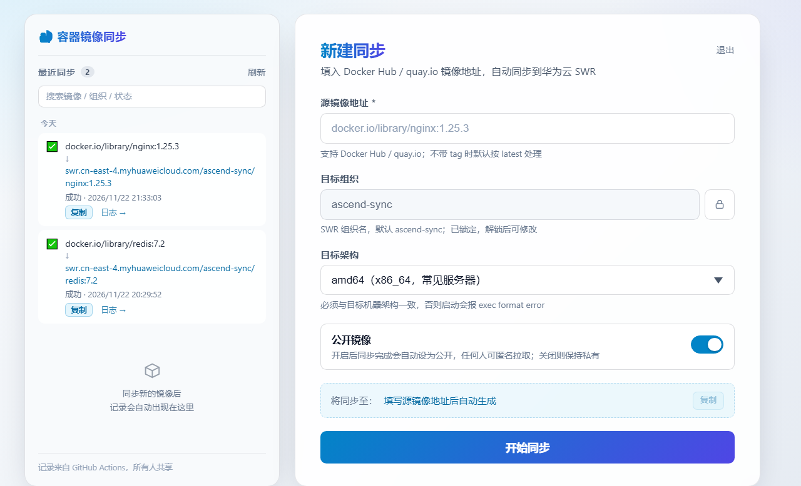

# dockerImageSync

[](https://github.com/Jason0816/dockerImageSync/actions/workflows/sync-images.yml)
[](LICENSE)
[](https://workers.cloudflare.com/)
[](https://www.huaweicloud.com/product/swr.html)
[](https://nodejs.org/)

把 Docker Hub / quay.io 的镜像同步到**华为云 SWR** 的轻量工具：填一个镜像地址，自动触发 GitHub Actions 完成拉取与推送，页面实时显示进度。

没有常驻服务器，全部跑在 GitHub Actions 与 Cloudflare Workers 的免费额度内。

---

## 目录

- [这个项目适合谁](#这个项目适合谁)
- [特性](#特性)
- [快速开始](#快速开始)
- [界面预览](#界面预览)
- [工作原理](#工作原理)
- [使用指南](#使用指南)
  - [选择目标架构](#选择目标架构)
  - [历史记录与搜索](#历史记录与搜索)
  - [管理员模式](#管理员模式)
- [自部署](#自部署)
  - [让 Agent 帮你部署](#让-agent-帮你部署)
  - [0. 前置条件](#0-前置条件)
  - [1. 准备华为云 SWR](#1-准备华为云-swr)
  - [2. 准备 GitHub 仓库与 Secrets](#2-准备-github-仓库与-secrets)
  - [3. 部署 Cloudflare Worker](#3-部署-cloudflare-worker)
  - [4. 本地预览](#4-本地预览)
  - [5. 验证](#5-验证)
  - [6. 部署检查清单](#6-部署检查清单)
- [配置参考](#配置参考)
- [API 参考](#api-参考)
- [常见问题](#常见问题)
- [目录结构](#目录结构)
- [安全与隐私](#安全与隐私)
- [贡献](#贡献)
- [许可证](#许可证)

---

## 这个项目适合谁

| 你是 | 从这里开始 |
|---|---|
| **想同步镜像**（已有别人部署好的实例） | [快速开始](#快速开始)，向实例管理员要访问口令即可 |
| **想自己部署一套** | [自部署](#自部署)，约 30 分钟；或让 [Agent 帮你部署](#让-agent-帮你部署) |
| **想改代码 / 二次开发** | [工作原理](#工作原理) + [API 参考](#api-参考) + [`CONTRIBUTING.md`](CONTRIBUTING.md) |

**能做什么**

- 把 Docker Hub、quay.io 的公开或私有镜像同步到自己的华为云 SWR
- 只拉指定 tag、只拉指定 CPU 架构，避免把多架构镜像整包搬过来
- 同步后自动把 SWR 仓库设为公开，直接 `docker pull` 可用
- 网页上看实时进度、查历史记录、按镜像名搜索

**不做什么**（避免误解）

- ❌ **不删除 SWR 里的镜像**：管理员删除功能删的是 GitHub Actions 运行记录，不是镜像本身
- ❌ 不做镜像扫描、签名、漏洞检测
- ❌ 目标固定为华为云 SWR；其他 registry 需自行改 `auth.yaml`（未验证）
- ⚠️ 源的地址解析遵循 Docker 规则：只写 `nginx` 会按 `docker.io/library/nginx` 理解

---

## 特性

- **零常驻服务器**：执行在 GitHub Actions，前端与代理跑在 Cloudflare Workers
- **不用填目标地址**：由源地址自动推导 SWR 路径，组织名可锁定防误改
- **只同步需要的**：默认单 tag + 指定架构（amd64 / arm64 / 两者），大幅减少流量与耗时
- **架构必选**：网页上没有默认值，未选择无法提交，避免"忘了选导致拉错架构"
- **看得见进度**：排队 / 执行中 / 逐步状态 / 成功失败，刷新不丢
- **失败有中文结论**：日志分类成「地址错误 / tag 不存在 / 架构不匹配 / 被限流 / 网络故障」，写入 Job Summary
- **无人值守**：连续 30 分钟没有新层完成（看门狗）自动终止，不会白跑一夜
- **全局历史 + 搜索**：记录存 Cloudflare D1，不受 GitHub 90 天保留期限制，可按镜像名 / tag / 架构搜索
- **同步统计**：侧栏底部常驻「近 30 天 N 次 · 成功率 · 均耗时」+ 迷你趋势图，点开看每日趋势、最慢 3 次、同步最多的镜像
- **管理员可清理**：管理员口令登录后可单条或批量删除历史记录，并保留可审计的软删除标记

---

## 快速开始

> 前提：有一个已部署好的实例地址（形如 `https://image-sync-proxy.<子域>.workers.dev`）和访问口令。

1. 打开实例地址，输入访问口令登录
2. 填**源镜像地址**，例如：
   - `docker.io/library/nginx:1.25.3`
   - `quay.io/prometheus/node-exporter:v1.7.0`
3. **选择目标架构**（必填）：见 [选择目标架构](#选择目标架构)
4. 确认「将同步至」预览行里的目标地址正确（组织名默认锁定）
5. 决定是否开启「公开镜像」（默认开启）
6. 点「开始同步」，页面实时显示进度

同步成功后即可拉取：

```bash
docker pull swr.cn-east-4.myhuaweicloud.com/ascend-sync/nginx:1.25.3
```

### 地址规则

| 你输入 | 实际同步到 |
|---|---|
| `docker.io/library/nginx:1.25.3` | `<registry>/<org>/nginx:1.25.3` |
| `docker.io/library/nginx` | `<registry>/<org>/nginx:latest`（自动补 `latest`） |
| `quay.io/ascend/cann:8.5.0` | `<registry>/<org>/cann:8.5.0`（仓库名取最后一段） |
| 任意镜像 + 解锁后填 `my-org` | `<registry>/my-org/<repo>:<tag>` |

`<registry>` 与默认 `<org>` 由部署者配置，默认分别是 `swr.cn-east-4.myhuaweicloud.com` 和 `ascend-sync`。

> **常见坑**：只写 `cann:8.3.rc1` 会被当成 Docker Hub 官方镜像 `docker.io/library/cann`，而它其实在 `quay.io/ascend/cann`。页面检测到"没写 registry"时会给出提示。

### 同步多个 tag

- 源地址带 tag → **只同步这一个**（默认行为）
- 需要多个时通过 API 传 `tags: "1.25.3,1.25.4"`；`all` 表示全量（不推荐，慢且容易触发限流）

---

## 界面预览

| 亮色主题 | 暗色主题 |
|:---:|:---:|
|  |  |

左侧是全局同步历史：支持搜索、日期分组、状态图标、耗时与架构、复制镜像名；右侧是新建同步表单，目标组织默认锁定，**目标架构必选**。

同步进度在右侧抽屉中展示；关闭抽屉后表单下方会出现「正在同步… · 查看进度」状态条，点击可重新打开。

---

## 工作原理

```text
浏览器（静态页面 + 口令登录）
   │  POST /api/sync { source, org, arch, public }
   ▼
Cloudflare Worker ── D1（历史索引，可选）
   │  POST /repos/{repo}/actions/workflows/sync-images.yml/dispatches
   ▼
GitHub Actions
   │  1. 根据 inputs 生成 images.yaml
   │  2. 下载 image-syncer 并执行（--arch 过滤平台）
   │  3. 失败则分类日志，写入 Job Summary
   │  4. 成功后调用 SWR API 把仓库设为公开
   ▼
华为云 SWR  ←── image-syncer ──→  Docker Hub / quay.io
```

**职责边界**

| 层 | 持有什么 | 做什么 |
|---|---|---|
| 前端（`web/`） | 无凭证 | 交互与展示 |
| Worker（`worker/`） | GitHub Token、访问口令、D1 | 校验、推导目标、触发工作流、查进度、写索引 |
| Workflow | SWR 凭证（GitHub Secrets） | 实际拉取与推送、设置公开 |

**费用**：Cloudflare Workers 免费计划 + GitHub Actions 免费额度 + D1 免费额度，个人使用量级下无需付费；SWR 侧的存储与流量按华为云计费规则为准（基础版目前有免费额度）。

---

## 使用指南

### 选择目标架构

| 选项 | 适用 | 说明 |
|---|---|---|
| `amd64` | x86_64 服务器、绝大多数云主机 | 最常用 |
| `arm64` | 鲲鹏 / 昇腾 / Apple Silicon / ARM 服务器 | 华为云 ARM 实例选这个 |
| 全部平台 | 两种架构都要用 | **实现上只同步 amd64 + arm64**，不含 386 / ppc64le / riscv64 / s390x |

不确定目标机器的架构时，在目标服务器执行：

```bash
uname -m        # x86_64 → amd64；aarch64 → arm64
```

选错架构会怎样：镜像没有该平台时 `image-syncer` 会静默跳过（日志 `no manifest fits`），工作流会**显式判定失败**并在 Job Summary 里提示切换架构，不会假装成功。

### 历史记录与搜索

- 默认列表来自 GitHub Actions 最近 15 次运行，带状态、耗时、架构、目标地址
- 输入关键字（≥1 字）会查询 **D1 索引**，匹配源地址 / 目标地址 / 仓库名 / tag / 架构
- 索引是永久的，不受 GitHub 运行记录保留期（默认 90 天）限制
- 未启用 D1 时仍可用，只是搜索范围仅限最近 15 条

启用方式见 [D1 索引](#d1-索引)。

### 管理员模式

部署者配置 `ADMIN_PASSWORD` 后，用该口令登录即可看到「管理」按钮：

| 操作 | 行为 |
|---|---|
| 单条删除（`✕`） | 删除该次运行及其日志，索引标记 `deleted_at` |
| 批量删除 | 勾选多条后点「删除选中」，单次最多 50 条 |
| 审计查询 | 勾选「含已删除」后搜索，可查到已删除记录（仅管理员生效） |

**删除的语义**：GitHub 上的运行与日志是**真删、不可恢复**；D1 只做软删除标记，因此仍可审计。**SWR 里的镜像不受影响。**

> 想彻底清理软删除记录：`DELETE FROM syncs WHERE deleted_at IS NOT NULL;`（见 [D1 索引](#d1-索引)）

---

## 自部署

以下流程约 30 分钟，全部使用免费额度。

### 让 Agent 帮你部署

仓库内置 DSH Skill（`.dsh/skills/deploy-image-sync/`）。在 DeepSeek Harness 中打开本仓库后直接说「帮我部署这个项目」，Agent 会自动加载技能：按步骤索取凭证、写入 Secrets、部署 Worker 并逐项验证。

它会**先确认凭证再动手**，不会猜默认值；全程中文交互，每次只问一组信息。技能自带排障手册（`references/`），出错时可按真实报错查原因。

### 0. 前置条件

| 需要 | 说明 |
|---|---|
| GitHub 仓库 | 存放工作流与配置，Actions 免费额度足够 |
| 华为云账号 | 已开通 SWR，并创建一个组织（如 `ascend-sync`） |
| Cloudflare 账号 | 部署 Worker + 静态页面（免费计划即可） |
| 本地环境 | 可选：Node.js ≥ 22（本地预览用） |

### 1. 准备华为云 SWR

1. **创建组织**：SWR 控制台 → 组织管理 → 创建组织（例如 `ascend-sync`）
2. **长期登录指令**：SWR 控制台 → 系统管理 → 长期有效登录指令 → 生成，记下：
   - 用户名（形如 `cn-east-4@XXXXXXXX`）→ `SWR_USERNAME`
   - 密钥 → `SWR_PASSWORD`

   > 不要用 24 小时临时登录指令，凭证过期后同步会失败。

3. **访问密钥（AK/SK）**：控制台 → 我的凭证 → 访问密钥 → `SWR_AK` / `SWR_SK`
4. **项目 ID**：控制台 → 我的凭证 → 项目列表 → 找到 `cn-east-4` 对应行 → `SWR_PROJECT_ID`

### 2. 准备 GitHub 仓库与 Secrets

Fork 或克隆本仓库，推送到自己的仓库。

**Actions Secrets**（Settings → Secrets and variables → Actions）：

| Secret | 必填 | 用途 |
|---|---|---|
| `SWR_USERNAME` | ✅ | SWR 长期登录用户名（`docker login` 用） |
| `SWR_PASSWORD` | ✅ | SWR 长期登录密钥 |
| `SWR_AK` | ✅ | 调用 SWR API 把仓库设为公开 |
| `SWR_SK` | ✅ | 同上 |
| `SWR_PROJECT_ID` | ✅ | `cn-east-4` 项目 ID |
| `SOURCE_DOCKERHUB_USER` / `SOURCE_DOCKERHUB_PASS` | ⬜ | 私有镜像或规避匿名限流（推荐配只读 Token） |
| `SOURCE_QUAY_USER` / `SOURCE_QUAY_PASS` | ⬜ | 私有 Quay 镜像 / 规避限流 |

> 未配置 `SWR_AK/SK/PROJECT_ID` 时，「设为公开」步骤会跳过，不影响同步。

**GitHub Token**（给 Worker 用）：Fine-grained Token，权限如下：

| 权限 | 级别 | 用途 |
|---|---|---|
| Actions | Read and write | 触发工作流、查询运行状态、删除运行 |
| Contents | Read and write | 推送代码（仅部署时用） |
| Workflows | Read and write | 允许推送 `.github/workflows/` 变更 |

### 3. 部署 Cloudflare Worker

Worker 同时托管 `/api/*` 与 `web/` 静态页面（同源，无需 CORS）。

```bash
cd worker
npx wrangler@latest deploy
```

首次部署会提示登录，或用环境变量：

```bash
export CLOUDFLARE_API_TOKEN='...'      # Workers Scripts:Edit（可选 D1:Edit）
export CLOUDFLARE_ACCOUNT_ID='...'
```

写入运行时配置：

```bash
cd worker
npx wrangler@latest secret put GITHUB_REPO      # 例：yourname/dockerImageSync
npx wrangler@latest secret put WORKFLOW_ID      # sync-images.yml
npx wrangler@latest secret put GITHUB_TOKEN     # 上一步的 Fine-grained Token
npx wrangler@latest secret put APP_PASSWORD     # 页面登录口令
npx wrangler@latest secret put ADMIN_PASSWORD   # 可选：管理员口令（可删除历史记录）
```

普通变量（`wrangler.toml` 的 `[vars]`，或同样用 `secret put`）：

| 变量 | 默认 | 说明 |
|---|---|---|
| `SWR_REGISTRY` | `swr.cn-east-4.myhuaweicloud.com` | 目标 Registry |
| `SWR_ORG` | `ascend-sync` | 默认组织 |
| `ALLOWED_ORIGIN` | `*` | 前后端分域部署时限定前端域名 |

部署完成后会输出访问地址，形如 `https://image-sync-proxy.<子域>.workers.dev`。

> `*.workers.dev` 在中国大陆网络下常需代理访问。要稳定公网入口，请绑定自定义域名（Workers 的自定义域名要求域名托管在 Cloudflare）。

### 4. 本地预览

```bash
cd worker
npx wrangler@latest dev
```

本地同样需要 `GITHUB_REPO` / `WORKFLOW_ID` / `GITHUB_TOKEN` / `APP_PASSWORD`，用一次性 `.dev.vars` 提供（**已被 `.gitignore` 忽略，不要提交**）：

```bash
cat > .dev.vars <<'EOF'
GITHUB_REPO=owner/repo
WORKFLOW_ID=sync-images.yml
GITHUB_TOKEN=github_pat_xxx
APP_PASSWORD=your-password
EOF
```

改代码后自动热重载。

### 5. 验证

**页面**

1. 打开实例地址，用 `APP_PASSWORD` 登录
2. 提交一个公开镜像，例如 `docker.io/library/hello-world:latest`，架构选 `amd64`
3. 到 GitHub Actions 确认三个步骤通过：`Generate images.yaml from inputs` / `Run image-syncer` / `Set SWR repositories public`
4. 回到页面确认显示成功；SWR 控制台能看到镜像，且可匿名 `docker pull`

**接口**

```bash
# 登录
curl -s -X POST https://<worker>/api/login \
  -H 'Content-Type: application/json' -d '{"password":"<口令>"}'

# 带令牌调用
curl -s https://<worker>/api/runs?limit=5 -H "Authorization: Bearer <token>"

# 鉴权是否生效（未带令牌应为 401）
curl -s -o /dev/null -w '%{http_code}\n' https://<worker>/api/config
```

### 6. 部署检查清单

**GitHub 侧**

- [ ] 仓库已推送，`.github/workflows/sync-images.yml` 在 `main` 分支
- [ ] Actions Secrets：`SWR_USERNAME`、`SWR_PASSWORD`、`SWR_AK`、`SWR_SK`、`SWR_PROJECT_ID`
- [ ] （推荐）`SOURCE_DOCKERHUB_USER/PASS`、`SOURCE_QUAY_USER/PASS`
- [ ] Fine-grained PAT 具备 `Actions` / `Contents` / `Workflows` 读写

**华为云侧**

- [ ] 目标组织已创建
- [ ] 使用的是**长期有效**登录指令（不是 24 小时临时指令）
- [ ] IAM 用户对 SWR 有写权限（否则「设为公开」失败）
- [ ] `auth.yaml` 的 key 与 `SWR_REGISTRY` 逐字一致

**Cloudflare 侧**

- [ ] Worker 部署成功，访问地址可打开
- [ ] Secrets：`GITHUB_REPO`、`WORKFLOW_ID`、`GITHUB_TOKEN`、`APP_PASSWORD`
- [ ] （可选）`ADMIN_PASSWORD`、D1 绑定
- [ ] 未登录访问 `/api/config` 返回 401

**端到端**

- [ ] 能登录并看到全局历史
- [ ] 触发一次同步，Actions 三个步骤状态正常
- [ ] SWR 里有镜像；公开仓库可匿名 `docker pull`
- [ ] （若启用 D1）搜索框能查到刚才那次同步

---

## 配置参考

### 工作流参数

`.github/workflows/sync-images.yml` 的 `workflow_dispatch` inputs：

| 参数 | 必填 | 说明 |
|---|---|---|
| `source` | ✅ | 源镜像地址，可带 tag |
| `destination` | ✅ | 目标镜像地址（由 Worker 生成，一般无需手填） |
| `tags` | ⬜ | 逗号分隔 tag；留空＝按源地址 tag（无 tag 则全量）；`all` 强制全量 |
| `arch` | ⬜ | `amd64` / `arm64` / `all`，**网页上必选无默认值**；不传时工作流回落到 `amd64` |
| `public` | ⬜ | 同步后是否设为公开，默认 `true` |
| `stall_timeout` | ⬜ | 无进展判定阈值（分钟），默认 `30` |

> `all` 的语义是「全部平台」，但实现上等价于 `--arch amd64 --arch arm64`，**不会**同步 386 / ppc64le / riscv64 / s390x。

### Worker 环境变量

| 变量 | 必填 | 说明 |
|---|---|---|
| `GITHUB_REPO` | ✅ | `owner/repo` |
| `WORKFLOW_ID` | ✅ | `sync-images.yml` |
| `GITHUB_TOKEN` | ✅ | Fine-grained Token（Actions / Contents / Workflows） |
| `APP_PASSWORD` | ✅ | 访问口令（未配置时接口返回 500，避免裸奔） |
| `ADMIN_PASSWORD` | ⬜ | 管理员口令；未配置时删除接口返回 501，功能关闭 |
| `SWR_REGISTRY` | ⬜ | 目标 Registry，默认 `swr.cn-east-4.myhuaweicloud.com` |
| `SWR_ORG` | ⬜ | 默认组织，默认 `ascend-sync` |
| `ALLOWED_ORIGIN` | ⬜ | CORS 白名单，默认 `*` |

### D1 索引

历史搜索需要可选的 D1 数据库；不配置也能用，只是搜索范围仅限最近 15 条运行。

```bash
cd worker
npx wrangler d1 create image-sync-index    # 记下返回的 database_id，写入 wrangler.toml
#   [[d1_databases]]
#   binding = "DB"
#   database_name = "image-sync-index"
#   database_id = "<上一步的 id>"

npx wrangler d1 execute image-sync-index --remote --file=schema.sql
npx wrangler deploy
```

**表结构**（`worker/schema.sql`）：`source` / `destination` 存**完整地址**；`registry` / `org` / `repo` / `tag` 是派生列（便于查询）；另有 `arch`、`conclusion`、`duration_seconds`、`created_at`、`finished_at`、`deleted_at`。

**写入时机**：触发成功后写入一条（`conclusion` 为空），前端轮询到结束时回填结论与耗时。

**回填已有历史**：从 GitHub 分页读取运行记录，解析 `run-name` 里的 `Sync <源> → <目标> [arch]` 后写入：

```sql
INSERT INTO syncs (run_id, source, destination, registry, org, repo, tag, arch,
                   conclusion, duration_seconds, created_at, finished_at)
VALUES (...)
ON CONFLICT(run_id) DO UPDATE SET ...;
```

> 早期 `run-name` 还是 `Sync Container Images` 的运行没有地址信息，无法回填。

**维护命令**：

```bash
# 查看软删除记录
npx wrangler d1 execute image-sync-index --remote \
  --command="SELECT run_id, source, deleted_at FROM syncs WHERE deleted_at IS NOT NULL;"

# 彻底清理软删除记录
npx wrangler d1 execute image-sync-index --remote \
  --command="DELETE FROM syncs WHERE deleted_at IS NOT NULL;"
```

### auth.yaml

image-syncer 的认证文件。**key 必须与镜像地址中的 hostname 完全一致**（不带 `https://`、不带路径），值通过环境变量注入：

```yaml
swr.cn-east-4.myhuaweicloud.com:
  username: ${SWR_USERNAME}
  password: ${SWR_PASSWORD}
docker.io:
  username: ${SOURCE_DOCKERHUB_USER}
  password: ${SOURCE_DOCKERHUB_PASS}
quay.io:
  username: ${SOURCE_QUAY_USER}
  password: ${SOURCE_QUAY_PASS}
```

> 目标区域不是 `cn-east-4` 时，必须同步修改这里的 key，否则认证失败。

---

## API 参考

除 `/api/login` 外均需请求头 `Authorization: Bearer <token>`（登录签发，7 天有效）。

| 方法 | 路径 | 说明 |
|---|---|---|
| `POST` | `/api/login` | `{password}` → `{ok, token, expires_at, role}` |
| `GET` | `/api/session` | 校验令牌 → `{ok, role, adminEnabled}` |
| `GET` | `/api/config` | registry / 默认组织（`default_arch` 仅供展示，前端不会自动选中） |
| `POST` | `/api/sync` | `{source, org?, arch?, public?}` → `{ok, run_id, html_url, destination}` |
| `GET` | `/api/status?id=` | 运行状态与步骤列表；完成时回写 D1 |
| `GET` | `/api/runs?limit=15` | 最近运行（标题含源 / 目标镜像） |
| `GET` | `/api/search?q=&limit=50&includeDeleted=1` | 查询 D1 索引；`includeDeleted` 仅管理员生效 |
| `GET` | `/api/stats?days=30` | 统计：`days` ∈ {7,30,90}，返回总数、成功率、平均/累计耗时、每日序列、最慢 3 次、Top5 镜像 |
| `DELETE` | `/api/runs/:id` | **管理员**：删除运行（含日志），D1 标记软删除 |
| `POST` | `/api/runs/bulk-delete` | **管理员**：`{ids:[...]}`，上限 50 条 |

错误响应统一为 `{ "error": "..." }`，状态码 `400 / 401 / 403 / 404 / 405 / 500 / 501 / 502`。

**权限**

| 能力 | `user` | `admin` |
|---|---|---|
| 查看 / 搜索历史 | ✅ | ✅ |
| 触发同步 | ✅ | ✅ |
| 删除单条 / 批量 | ❌ 403 | ✅ |
| 搜索含已删除记录 | ❌ 参数被忽略 | ✅ |
| 未配置 `ADMIN_PASSWORD` 时删除 | ❌ 501 | ❌ 501 |

> 令牌格式 `v1.<role>.<exp>.<hmac>`，角色由 HMAC 保护，无法伪造。格式变更后旧令牌一次性失效，需重新登录。

---

## 常见问题

### 同步相关

**同步很慢，或长时间没有日志？**

先分清两种情况：

1. **正常慢**：跨境拉取实测约 3–4 MB/s，6.7GB 镜像约需 18–20 分钟。image-syncer 只在每个层传完后打日志，单个大层（比如 4GB）在传输过程中会长时间没有输出
2. **真的卡死**：连接挂住、不报错也不前进。工作流内置看门狗，连续 `stall_timeout`（默认 30 分钟）没有新层完成就自动终止并标红

看门狗误判时（单层超过 10GB 且链路慢），把 `stall_timeout` 调大重跑即可。**已完成的层会留在 SWR 中，重跑自动跳过。**

**超大镜像（GB 级）反复失败？**

优先确认是否配置了源端只读凭证（`SOURCE_QUAY_USER/PASS` 或 `SOURCE_DOCKERHUB_USER/PASS`）。匿名拉取在传大层时更容易被限流甚至静默中断。

**日志显示 429 / 拉取失败？**

Docker Hub 对匿名拉取按 IP 限流（GitHub runner 共享出口）。配置 `SOURCE_DOCKERHUB_USER` / `SOURCE_DOCKERHUB_PASS`（只读 Access Token 即可）可缓解。

**提示认证错误？**

检查 `auth.yaml` 的 key 是否与目标 hostname 逐字一致；确认使用的是「长期有效登录指令」而非临时指令。

**推送报 `organization not found`？**

目标组织必须先在 SWR 控制台创建。

**架构选错了会怎样？**

镜像没有该平台时 `image-syncer` 会跳过（日志 `no manifest fits`）并以 0 退出。工作流已显式检测：`Run image-syncer` 步骤**失败**，Job Summary 写明「镜像没有提供 xx 平台的 manifest」。

> 区分：**tag 不存在**会直接报错失败；**架构不匹配**原本是静默跳过，现已改为显式失败。

**Actions 显示成功，但 SWR 里没有镜像？**

先确认架构是否选对（见上条）。若架构正确，检查是否解锁组织后改成了别的组织名。

### 使用相关

**容器启动报 `exec format error`？**

镜像架构与机器不符：ARM 机器（鲲鹏 / 昇腾）需选 `arm64`。

**搜索框搜不到几个月前的记录？**

默认只读 GitHub 最近 15 条运行，且 GitHub 只保留一定期限（默认 90 天）。要搜更早的记录需启用 [D1 索引](#d1-索引)。

**「管理」按钮不显示，或删除报 403？**

删除需要管理员角色：部署者必须配置 `ADMIN_PASSWORD`，并用它登录。普通口令只能查看与触发。

**删除后还能查到这条记录吗？**

能，但只在管理员勾选「含已删除」的搜索结果中。GitHub 上的运行与日志是真删，D1 只保留软删除标记用于审计。

**勾选多条后点「删除选中」没反应？**

确认处于管理模式、至少勾选一条，且运行不是「进行中」（GitHub 不允许删除运行中的任务，需先取消）。

**页面提示「未登录或登录已过期」？**

口令被修改过，或令牌超过 7 天，重新登录即可。

**关闭「公开镜像」后仓库还是公开的？**

该开关只控制「是否自动设为公开」。关闭后工作流跳过设置步骤，**不会**把已存在的公开仓库改回私有；需要私有请到 SWR 控制台修改，或改造该步骤强制 `is_public: false`。

### 部署相关

**推送 GitHub 报 403？**

Token 缺少 `Contents` 或 `Workflows` 权限，补上后重新推送。

**Cloudflare 返回 `error code: 1010`？**

安全策略拦截了非常规 UA（如 Python `urllib`），与本站逻辑无关；用浏览器或 `curl` 访问即可。

**`wrangler d1` 报 `401 Authentication error`？**

Token 没有 D1 权限。在 Cloudflare API Token 里给 Account 增加 `D1: Edit`。

**`*.workers.dev` 打不开？**

中国大陆网络下常需代理。要稳定访问请绑定自定义域名（域名需托管在 Cloudflare）。

---

## 目录结构

```text
.
├── .dsh/skills/deploy-image-sync/      # 部署技能（Agent 辅助自部署）
│   ├── SKILL.md
│   └── references/                     # cloudflare / huaweicloud / troubleshooting
├── .github/workflows/sync-images.yml   # 同步工作流
├── auth.yaml                           # image-syncer 认证（环境变量占位）
├── images.yaml                         # 默认同步规则（运行时被覆盖）
├── CONTRIBUTING.md                     # 提交信息与验证规范
├── scripts/
│   ├── make_repo_public.py             # 同步后把 SWR 仓库设为公开
│   └── classify_sync_failure.py        # 失败日志 → 中文归类 + Job Summary
├── worker/
│   ├── index.js                        # Worker：鉴权 + 触发 + 查询 + 删除
│   ├── wrangler.toml                   # Worker 配置（静态资源 + D1 绑定）
│   ├── schema.sql                      # D1 表结构
│   └── package.json
├── web/
│   ├── index.html                      # 页面与样式（CSS 变量主题）
│   └── app.js                          # 登录 / 表单 / 轮询 / 历史
├── docs/                               # 界面截图
├── README.md
└── LICENSE
```

---

## 安全与隐私

- 前端与 Worker 源码中**不含**任何 SWR AK/SK 或 GitHub Token
- `auth.yaml` 只保留环境变量占位符，真实凭证存放在 GitHub Secrets
- 访问口令建议使用 **16 位以上随机串**；修改口令后所有已登录设备立即失效
- 建议给 GitHub Token / Cloudflare Token 设置较短有效期并定期轮换
- **公开镜像任何人可匿名拉取**：镜像含敏感内容时请谨慎开启自动公开
- 管理员删除是**不可逆**操作（含日志），生产环境请注意授权范围
- 需要更强防护时，可在 Cloudflare 前叠加 Access（SSO / IP 白名单）
- 本项目为个人开源工具，**非华为云或 Docker 官方产品**，使用前请自行评估合规性

---

## 贡献

改动前请先读 [`CONTRIBUTING.md`](CONTRIBUTING.md)。要点：

- **提交信息一律英文**，格式 `<type>(<scope>): <subject>`
- 一次提交只做一件事；相邻同类微调在推送前合并
- 改写历史后用 `--force-with-lease` 并显式指定期望的远程 SHA
- 行为变化时同步更新本文件与 `.dsh/skills/deploy-image-sync/`
- 文本文件统一 UTF-8 + LF；凭证只走 `wrangler secret` / GitHub Secrets

---

## 许可证

[MIT](LICENSE) © 2026 Jason0816